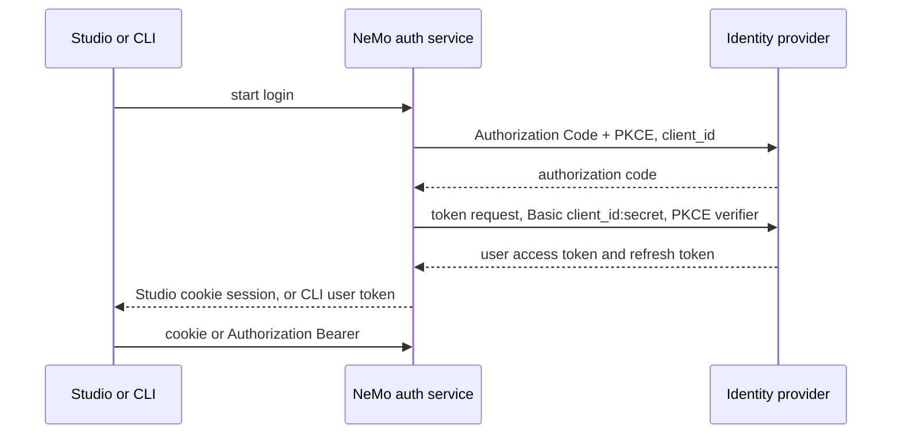

Use this page when your identity provider requires a confidential OAuth client with Client Secret Basic. NeMo Helix's auth service is that client. Studio and the CLI never see the client secret.



## Register the application

1. Create an Authorization Code + PKCE application in the identity provider.
2. Set token endpoint authentication to Client Secret Basic.
3. Register one redirect URI: `https://<nemo-host>/apis/auth/v2/login/callback`.
4. Do not register the CLI's localhost address. The CLI browser returns to NeMo, and NeMo finishes the handoff on `127.0.0.1`.

## Configure NeMo Helix

Store the client secret and the session encryption key in the process environment. The config file stores only the variable names.

```yaml
auth:
  enabled: true
  oidc:
    enabled: true
    issuer: "https://idp.example.com"
    client_id: "<confidential-client-id>"
    token_endpoint_auth_method: client_secret_basic
    client_secret_env_var: NHX_OIDC_CLIENT_SECRET
    session_encryption_key_env_var: NHX_AUTH_SESSION_ENCRYPTION_KEY
```

`client_id` is the default login client. Add `public_client_id` only when this deployment also has a separate public client for device flow. That public client is never the default.

Studio signs in through the cookie session. `nemo auth login` stores the user access token and sends `Authorization: Bearer` on later API calls. Refresh for that login goes back through NeMo, which still holds the client secret.

Password grant is not available for this client. Run `nemo auth login` and complete the browser prompt.
