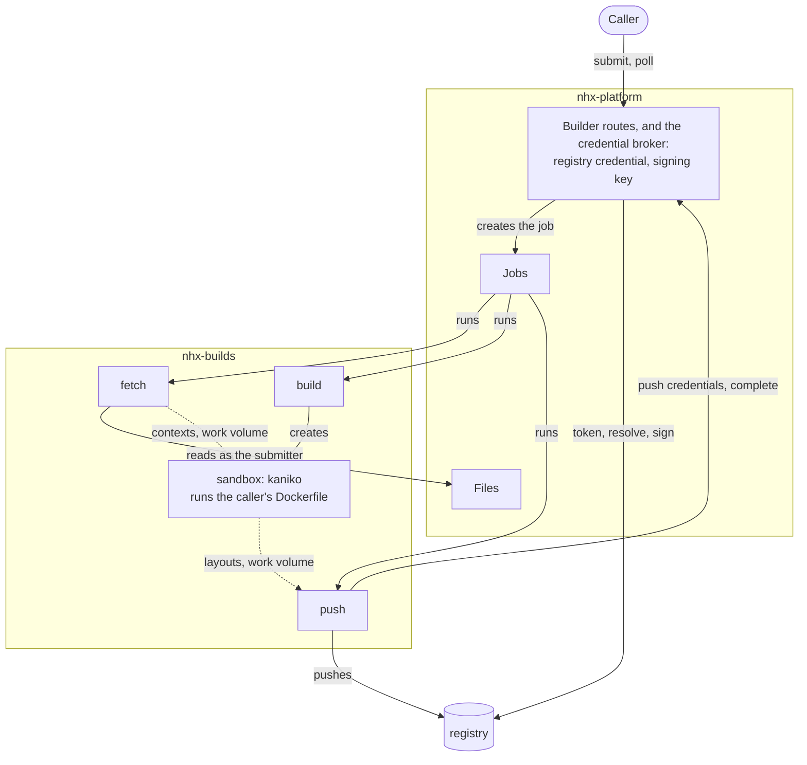
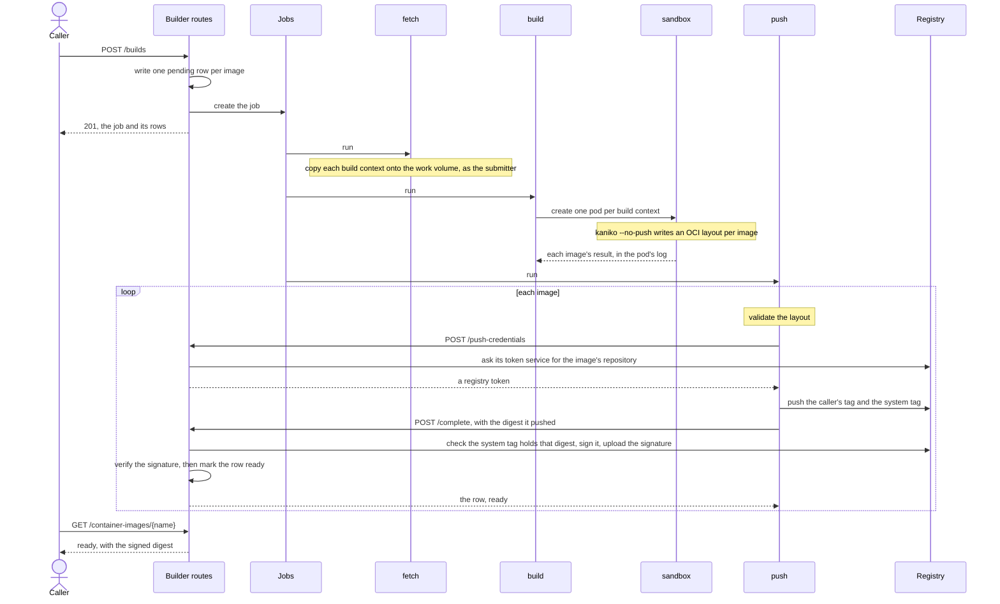
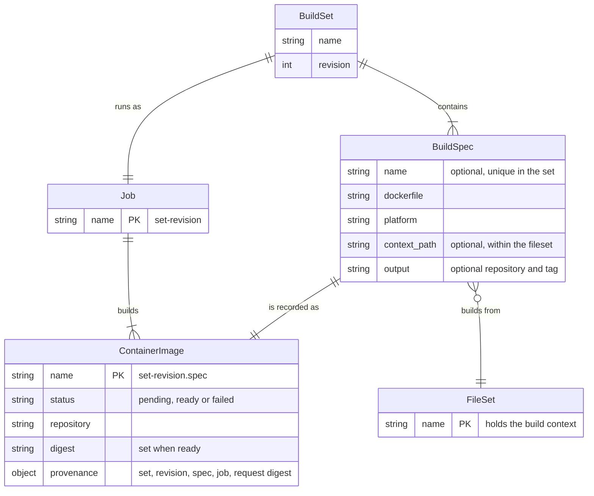
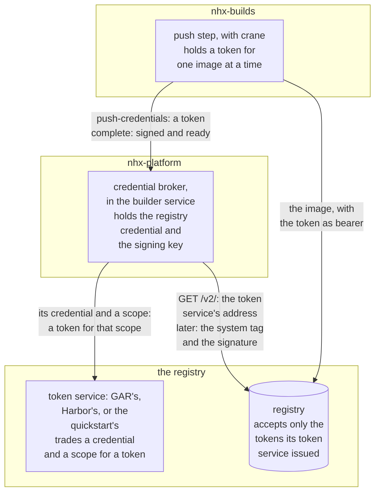
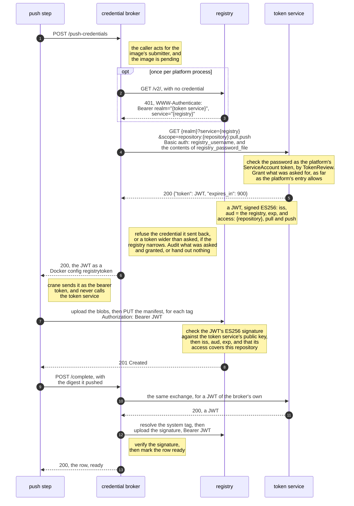

<!-- SPDX-FileCopyrightText: Copyright (c) 2025-2026 NVIDIA CORPORATION & AFFILIATES. All rights reserved. -->
<!-- SPDX-License-Identifier: Apache-2.0 -->

# NeMo Builder Plugin

Container image builds for NeMo Helix. A caller submits Dockerfiles whose build context is already
in a Files fileset. The plugin builds them with kaniko in a sandbox pod that holds no credentials.
The build's last step publishes each image with a registry token the builder gets it for exactly
that image's repository, then asks the builder to complete it: the builder signs the digest the step
pushed, if the image's tag still holds it, and records it as a `ContainerImage` entity that
consumers can pin.

**Status: proof of concept.** It runs end to end on minikube. It is not a uv workspace member, is
not in the Helm chart, and has the limitations listed under [Constraints](#constraints).

## Surfaces

- **REST:** `POST /apis/builder/v2/workspaces/{workspace}/builds` submits a build;
  `GET .../container-images` and `GET .../container-images/{name}` read the results; and
  `POST .../container-images/{name}/push-credentials` and `POST .../container-images/{name}/complete`
  are how a build's last step publishes and completes an image.
- **Entity:** `ContainerImage` (`entity_type="container_image"`), one row per image.
- **Programs:** `nhx-build {fetch|supervise|push}`, which the build job's steps run. They ship in the
  `nhx-build` image (`docker/Dockerfile`), along with `nhx-build token-server`, a local-only stand-in
  for a registry's token service. The credential broker isn't a program of its own: it runs in the
  platform, behind the last two routes.

There is no CLI or SDK accessor yet; use the REST API.

## How it works

Images are built in this cluster, by the `execution` backend. A submitted build set becomes one
Jobs job with three steps, each under its own ServiceAccount. The caller's Dockerfile runs in a
fourth pod, the sandbox, which is not a job step and holds nothing:

| | Runs as | Holds | Work volume | Runs caller code |
|---|---|---|---|---|
| `fetch` | `nhx-build-fetch` | a Files client, acting as the submitter | yes | no |
| `build` (runs `nhx-build supervise`) | `nhx-build-control` | permission to manage pods in `nhx-builds` | no | no |
| sandbox (kaniko) | no ServiceAccount token | nothing | its own context read-only, and one output directory per image | yes |
| `push` | `nhx-build-push` | nothing: no RBAC, no Secret, no key | yes | no |
| credential broker, in the platform | the platform's ServiceAccount | the registry credential and the signing key | no | no |

Where each one runs, and what it reaches:



No step can read a credential through its identity. `jobs.create` is in the Editor role and
execution profiles are not authorized, so anyone who can submit a build can run a raw job as any of
these identities. Under `nhx-build-push` the identity itself adds nothing, since the builder hands
out registry tokens and signatures by platform identity, not by ServiceAccount. Such a job can still
publish and complete the submitter's pending images, as any job step acting for them can, and with
platform auth off anything can. Under `nhx-build-control` it gains far more. All of this is under
[Constraints](#constraints).

One build, end to end:



1. **Submit.** The request is resolved into a plan: a job name, and a row name for each image. The
   backend then places each image -- registry, repository and system tag -- and refuses at submit
   anything it cannot honor. The system tag is a tag the build pushes alongside the caller's, and
   the one the builder checks and signs; its form is under
   [Names](#get-container-images-and-get-container-imagesname). One `ContainerImage` row per image
   is created `pending`, then the job. Each row records a digest of the request, so submitting the
   same request again returns the same rows, and a different request under the same `name` and
   `revision` is refused.
2. **`fetch`** clears anything an earlier run of the job left behind, then copies each fileset, or
   just its `context_path`, onto the work volume as the submitting user. A request naming a
   fileset the submitter can't read fails here.
3. **`build`** creates one sandbox pod per distinct fileset and `context_path`. The sandbox runs
   kaniko once per image with `--no-push`, writing an OCI layout to that image's output directory,
   which it empties first. The sandbox has:
   - no ServiceAccount token, environment variables or secrets
   - a security context the `baseline` Pod Security Standard admits: root, but with only five
     capabilities, `RuntimeDefault` seccomp and no privilege escalation
   - public DNS resolvers rather than cluster DNS
   - a deadline the kubelet enforces, so it ends even if `supervise` is killed first

   Nothing restricts its network yet (see [Constraints](#constraints)). `supervise` mounts no
   volume itself; it reads each image's pass or fail from the sandbox's log, which only affects its
   own exit code and logs.
4. **`push`** treats each layout as untrusted. It refuses symlinks, special files, blobs that
   don't hash to their names, and anything but a single manifest. For each image it then, as the
   submitter:
   - asks the builder for push credentials, and gets a registry token for the image's repository;
   - pushes the caller's tag and the system tag with crane;
   - asks the builder to complete the image, naming the digest it pushed.
5. **Completing** is the builder's. It resolves the image's system tag itself and refuses unless
   the tag holds the digest `push` named. Then it signs that digest with a key no step can read,
   every annotation taken from the row, checks the signature under the deployment's public key, and
   marks the row `ready` with the signed digest. Nothing that ran the Dockerfile reports an image's
   digest, and the digest `push` names is only checked, never trusted.

One failed Dockerfile doesn't stop the rest of the set: the other images still build, publish and
complete. The failed image's row stays `pending`, since nothing fails it yet (see
[Constraints](#constraints)). If every image in a set fails, `push` never runs.

Every step finds files on the work volume through one `WorkLayout` (in `steps.py`). Step configs
name filesets and images, never paths, and no step config carries a credential or the name of one.

## API

All routes are under `/apis/builder/v2/workspaces/{workspace}`.

A request is a `BuildSet`: a name, a revision, and up to 100 `BuildSpec`s. The set runs as one
Jobs job, and each spec becomes one `ContainerImage` row. The request itself isn't stored; each row
records where it came from in its `provenance`.



### `POST /builds`

```json
{
  "name": "hello",
  "revision": 1,
  "build_specs": [
    {
      "name": "main",
      "source": {"fileset": "hello-context", "context_path": null},
      "dockerfile": "Dockerfile",
      "platform": "linux/amd64",
      "output": {"repository": "demo/hello", "tag": "v1"}
    }
  ]
}
```

| Field | Meaning |
|---|---|
| `name` | What is being built. Reused across rebuilds. Lowercase letters, digits and single hyphens, starting with a letter, and short enough that every name built from it fits in 63 characters. |
| `revision` | The caller's own version number for `name`, starting at 1. Use a new revision for every build. |
| `build_specs` | Up to 100 specs. |
| `build_specs[].name` | The image's name within the set, unique in it: lowercase letters and digits, joined by single `.`, `_` or `-`. It names the image's row, `<name>-<revision>.<spec>`, and an image with no `output` is published under it. One spec in a set may leave it out: its row is `<name>-<revision>`. |
| `source.fileset` | The fileset holding the build context: `name` in this workspace, or `workspace/name`. |
| `source.context_path` | Optional subdirectory of the fileset to use as the context. Relative, with no `..`. Omit it to use the whole fileset. |
| `dockerfile` | Path relative to the context. Absolute paths and `..` are rejected. Defaults to `Dockerfile`. |
| `platform` | Passed to kaniko. Defaults to `linux/amd64`. |
| `output.repository`, `output.tag` | Optional. Where the image is published, within your workspace's part of the registry. Tags containing `--` or starting with `sha256-` are reserved for system tags and signatures. |

Every request model rejects fields it doesn't know, so a misspelt field is a `422` rather than
silently ignored.

Every image goes to the deployment's one registry. With an `output`, at
`<registry>/<repository_prefix>/<workspace>/<output.repository>:<output.tag>`; without one, at
`<registry>/<repository_prefix>/<workspace>/<name>/<build_specs[].name>`, or
`<registry>/<repository_prefix>/<workspace>/<name>` for the unnamed spec, under the system tag only.
A caller can't name a registry: whatever runs the image has to pull it, and one registry means one
pull credential for every workload that does. The workspace in the path keeps workspaces out of
each other's repositories.

A successful submit returns `201` with the job name and the `pending` rows. Poll the rows, not
the job: images in a set finish independently.

| Status | When |
|---|---|
| `201` | Rows created and job submitted, or the same request was submitted before and these are its rows and job. |
| `400` | Two specs would publish the same `repository:tag`, or the workspace name can't be a repository path component. |
| `403` | The caller may submit builds but may not create jobs in the workspace. |
| `409` | This deployment can't build: `registry`, `sandbox_image` or `signing_public_key` is unset, or a setting the credential broker needs (`registry_username`, `registry_password_file`, `signing_key`). Or this `name` and `revision` were already submitted with a different request, or its job's name is held by a job this request didn't create; any rows this request wrote are then failed. |
| `422` | The body failed validation: for example a path outside the context or fileset, a set or spec name that doesn't fit, more than 100 specs, duplicate spec names, a `revision` below 1, a repository or tag that isn't valid or is reserved, or an unknown field such as `output.registry`. |
| `502` | Another platform service refused the build. |
| `500` | Anything else. |

### `GET /container-images` and `GET /container-images/{name}`

`GET /container-images` accepts `page` and `page_size` (at most 100), and two filters: `job`, a job
name this submit returned, and `status`. `GET /container-images/{name}` returns `404` for a name
that doesn't exist. Each row is a `ContainerImage`:

| Field | Meaning |
|---|---|
| `status` | `pending`, `ready` or `failed`. `ready` is written only once the builder has signed the image's digest, and `failed` only when the submit that wrote the row was refused. Both are final. |
| `status_detail` | Why a row failed. |
| `registry`, `repository` | Where the image lives. |
| `digest` | The digest the signature covers, set once when the row becomes `ready`. Pin `<registry>/<repository>@<digest>`. |
| `signature` | Set once the row is `ready`. `verified_against` names the public key the signature verifies under (`key:sha256:<fingerprint>`), and `signer` the claims it carries, all taken from this row. |
| `platform` | The platform the image was built for. |
| `provenance` | The build set, revision, spec and job that produced the image, and `request_digest`, the digest of the request that did. `spec` is null for the unnamed spec. |

Names are derived from the request:

| | Pattern | Example |
|---|---|---|
| Job | `<set>-<revision>` | `hello-1` |
| Row | `<set>-<revision>.<spec>`, or `<set>-<revision>` for the unnamed spec | `hello-1.tests`, `hello-1` |
| System tag | `<workspace>--<row>` | `default--hello-1` |

### `POST /container-images/{name}/push-credentials` and `POST /container-images/{name}/complete`

What a build's push step calls, for one image, as the image's submitter. The caller must hold
`builder.container-images.complete`, which the Editor role has. With platform auth on it must also
be a job step acting for the image's submitter: a user's own token is refused, since whoever could
hold a push token, or have a digest signed, could publish anything as built here. Nothing yet ties
the call to the image's own job (see [Constraints](#constraints)).

`push-credentials` takes no body. For a `pending` image it returns a registry token for the image's
repository, as the Docker config crane reads:

```json
{"auths": {"<registry>": {"registrytoken": "<token>"}}, "expires_in": 300, "narrowed": true, "repository": "<repository>"}
```

`complete` takes the digest the push step pushed, `{"digest": "sha256:…"}`. The builder resolves the
image's system tag, refuses unless it holds that digest, signs it, checks the signature under the
deployment's public key, and makes the row `ready` with one write, conditional on the row's version.
Completing an image already `ready` at that digest returns it, so a retry is safe.

| Status | When |
|---|---|
| `200` | A token for the image's repository; or the image is `ready` at the digest -- now, or already. |
| `403` | The caller isn't a job step acting for the image's submitter, or the image's repository or name is one the builder won't publish. |
| `404` | No such image. |
| `409` | The image has settled -- for `complete`, as `ready` at another digest, or `failed` -- or its system tag holds another digest, or the deployment lacks a setting the broker needs. |
| `422` | `complete`'s body is anything but a sha256 digest. |
| `502` | The registry's token service, or signing, failed or refused. |
| `503` | The audit line couldn't be written, so nothing was issued or signed. |

## The credential broker

The build plane's credential authority is part of the builder service: it runs in the platform,
behind the two routes above, and holds the registry credential and the signing key. No build step
holds either. Anything that compromises the platform process can reach them, as it can the Secrets
service's key. A KMS would keep the signing key's private half out of the process, but isn't
supported yet (see [Constraints](#constraints)).

What each part holds, and whom it calls:



One image's tokens, as the quickstart runs them, from the registry's challenge to the signature:



**Identity.** The caller is whoever the platform authenticated. With platform auth on and workload
token exchange, a job step presents the token Jobs gives it -- the platform's own workload identity,
the same on Docker and Kubernetes -- whose principal is the step, acting for the job's submitter.
The broker requires a caller acting for the image's submitter, the row's `created_by`. The token
doesn't say which job the step belongs to, so any job step acting for that submitter qualifies (see
[Constraints](#constraints)). With platform auth off, no caller is checked.

**Entitlement.** A step never names a scope. A token is for the image's repository, pull and push,
and only while the image is `pending`. Rows are data, so the repository must parse and lie under
`<repository_prefix>/<the image's workspace>/`, and the workspace and name must make a valid system
tag, before either reaches a token scope or a reference.

**Registry credentials.** The broker holds one credential for the registry and asks the registry's
own token service -- the realm in its `401` challenge, per the Distribution token specification --
for `repository:<repository>:pull,push`. It hands on what the registry issues as a Docker config
`registrytoken`, which crane sends directly. How long the token lives is the token service's
choice; the broker reports it, from the token itself where it can be read. Whether the registry
narrowed the token is reported the same way; with `registry_narrows_scope` set, a readable token
wider than the request is refused. A registry that answers with a Basic challenge is refused, and
so is a token service that hands back the credential it was given: the broker does not hand out its
own credential.

**Signing.** `complete` names a digest, and the broker signs it only if the image's system tag holds
it. It resolves the tag with a token it gets for itself, refuses an index, and signs the digest with
the deployment's key, every annotation from the row. The signature is in cosign's format and stored
beside the image, where cosign looks for it, so `cosign verify --key` checks it; nothing goes to a
transparency log. A `signing_key` that isn't the key `signing_public_key` names refuses every
submit, and each signature is checked under `signing_public_key` before its row becomes `ready`.

**Audit.** Every token issued, every signature -- before it is made, naming the digest, and again
with its outcome -- and every refusal is a line on the platform's stdout, prefixed `audit`, naming
the image, the caller and whom it acts for. A token's line records what was asked for and what the
token says it grants. If a token's or a signature's line can't be written, nothing is issued and
nothing is signed.

## Configuration

Operator settings live under `builder:` in the platform config, or in `NEMO_BUILDER_*` environment
variables. Callers can't set any of them.

```yaml
builder:
  namespace: nhx-builds
  work_pvc: nhx-build-work
  sandbox_image: my-registry/nhx-kaniko:v1.25.19 # built from docker/Dockerfile.kaniko
  registry: us-central1-docker.pkg.dev           # a host only, never host/path; http://host for plain HTTP
  repository_prefix: my-project/my-repo          # images land at <prefix>/<workspace>/...
  registry_narrows_scope: false                  # true only for a registry measured to narrow tokens
  registry_username: builder                     # the broker's credential for the registry's token service
  registry_password_file: /var/run/secrets/registry/password
  signing_key: /var/run/secrets/signing/signing.key  # a PEM private key, EC or RSA
  signing_key_password_file: /var/run/secrets/signing/password  # its password, if the PEM is encrypted
  signing_public_key: |                          # the signing key's public half
    -----BEGIN PUBLIC KEY-----
    ...
```

Six settings have no safe default: `registry`, `sandbox_image`, `signing_public_key`, and the
credential broker's `registry_username`, `registry_password_file` and `signing_key`. If any is
missing, submits fail with a `409` rather than as a build that dies in a pod. The password file is
re-read on every use, so it can be a mounted Secret or a projected ServiceAccount token the kubelet
rotates.

**The registry must accept nested repository paths, and create a repository on its first push**, as
Artifactory, GAR, Harbor and Distribution do. Docker Hub and nvcr.io don't: each repository there
must be created first, and names have a fixed depth.

**Set `registry_narrows_scope` only for a registry measured to narrow tokens.** When it is set, the
broker refuses a token wider than it asked for. Narrowing is the token service's job, not the
registry's: the quickstart's stand-in narrows, as the token specification requires, and
Artifactory's token service doesn't.

**Set `repository_prefix` to a path dedicated to builds.** Left empty, each workspace name is a
top-level namespace in the registry, and the broker's registry credential can write all of them: a
workspace named after the namespace your platform images live in would publish over them.

The platform also needs three Jobs execution profiles, one per step, named by `fetch_profile`,
`control_profile` and `push_profile` (`build-fetch`, `build-control` and `build-push` by default).
Each is a `cpu` profile on the `kubernetes_job` backend, and they must agree with the builder
config and the manifests:

- `namespace` is the builder's `namespace`, and `storage.pvc_name` is its `work_pvc`
- `service_account_name` is `nhx-build-fetch`, `nhx-build-control` or `nhx-build-push`
- `default_task_image` is the `nhx-build` image, and `launcher_image` an image that ships
  `/tools/jobs-launcher`, as the platform image does
- `node_selector` is the build node's label

`config/platform-config.minikube.yaml` is the quickstart's config. It works, but it is local-only
in the ways its header lists, auth being off among them; don't start a shared deployment from it.

The remaining settings are `sandbox_cpu`, `sandbox_memory`, `sandbox_dns_nameservers` and
`node_selector`. Each is described on `BuilderConfig` in `config.py`.

## Quickstart (minikube)

This runs the platform, with the builder and its credential broker, and a token-auth registry inside
minikube, builds one image, and checks the result. Run the commands from the repository root, in one shell: later steps use
variables earlier ones set.

You need Docker with the default buildx driver, minikube, `kubectl`, `openssl`, `jq`, and the `nemo`
CLI (`make bootstrap`; see [SETUP.md](../../SETUP.md)). The cluster below uses 3 CPUs and 5.5 GB of
memory. Sandboxes resolve names with `8.8.8.8` and `1.1.1.1`, so the network must allow DNS to
them; some corporate networks and VPNs don't.

**1. Cluster.** The work volume is `ReadWriteOnce`, so every build pod runs on the node labelled
`nhx.nvidia.com/build-node=true`.

```bash
minikube start --driver=docker --cpus=3 --memory=5500
kubectl label node minikube nhx.nvidia.com/build-node=true
```

**2. Images.** Build the platform image with this plugin added, the image the build steps run in,
and the sandbox's kaniko image. Use `linux/amd64` instead of `linux/arm64` on an
x86 machine.
`Dockerfile.platform` starts `FROM` the local `my-registry/nhx-api:local`, which only the default
`docker` buildx driver can see; with a `docker-container` builder selected, run
`docker buildx use default` first.

```bash
# nhx-api, with the Studio UI stubbed out; the builder doesn't use it
mkdir -p /tmp/empty-studio/artifacts && touch /tmp/empty-studio/artifacts/.keep
docker buildx bake -f docker-bake.hcl nhx-api-docker --load \
  --allow=fs.read=/tmp/empty-studio --set '*.platform=linux/arm64' \
  --set nhx-api-docker.contexts.nhx-studio-ui=/tmp/empty-studio

docker buildx build --platform linux/arm64 -f plugins/nemo-builder/docker/Dockerfile.platform \
  --build-arg NHX_API_IMAGE=my-registry/nhx-api:local -t nhx-api-builder:local --load .
docker buildx build --platform linux/arm64 -f plugins/nemo-builder/docker/Dockerfile \
  -t nhx-build:local --load .
docker buildx build --platform linux/arm64 -f plugins/nemo-builder/docker/Dockerfile.kaniko \
  -t nhx-kaniko:local --load plugins/nemo-builder/docker

minikube image load nhx-api-builder:local
minikube image load nhx-build:local
minikube image load nhx-kaniko:local
```

`minikube image load` doesn't reliably replace an image already loaded under the same tag. When
you rebuild, use a new tag, and update `deploy/` and the config to match.

**3. Keys.** Two keys, both for this cluster only, in a temporary directory rather than the
repository: the builder's signing key, which signs every image, and the local token service's key,
which signs registry tokens. The registry trusts the second through a JWKS derived from it. Keep
`$KEYS/signing.pub` to verify signatures later. The JWKS comes out of the `nhx-build` image through
a pipe, since Docker's VM may not share `$KEYS` with containers.

```bash
KEYS=$(mktemp -d)
openssl ecparam -name prime256v1 -genkey -noout | openssl pkcs8 -topk8 -nocrypt -out "$KEYS/signing.key"
openssl pkey -in "$KEYS/signing.key" -pubout -out "$KEYS/signing.pub"
openssl ecparam -name prime256v1 -genkey -noout | openssl pkcs8 -topk8 -nocrypt -out "$KEYS/token-server.pem"
docker run --rm -i nhx-build:local nhx-build token-server jwks < "$KEYS/token-server.pem" > "$KEYS/jwks.json"
```

**4. Deploy.** `deploy/` has one manifest per namespace:

| File | Namespace | What runs there |
|---|---|---|
| `builds.yaml` | `nhx-builds` | The build jobs and their sandboxes, with the step ServiceAccounts, their RBAC, and the work volume |
| `platform.yaml` | `nhx-platform` | The platform services the builder uses, with its credential broker, in one pod with SQLite |
| `registry.yaml` | `nhx-registry` | A registry at `registry.nhx-registry.svc.cluster.local:5000` with token auth, and a local stand-in for its token service |

```bash
kubectl apply -f plugins/nemo-builder/deploy/
kubectl -n nhx-platform create configmap nemo-helix-config \
  --from-file=config.yaml=plugins/nemo-builder/config/platform-config.minikube.yaml
kubectl -n nhx-registry create secret generic nhx-token-server-key --from-file=key.pem="$KEYS/token-server.pem"
kubectl -n nhx-registry create configmap registry-token-jwks --from-file=jwks.json="$KEYS/jwks.json"
kubectl -n nhx-platform create secret generic nhx-build-signing-key --from-file=signing.key="$KEYS/signing.key"
kubectl -n nhx-platform create configmap nhx-build-signing-public-key --from-file=signing.pub="$KEYS/signing.pub"

kubectl -n nhx-registry wait --for=condition=Ready pod --all --timeout=300s
kubectl -n nhx-platform wait --for=condition=Ready pod -l app=nemo-helix --timeout=600s
kubectl -n nhx-platform port-forward svc/nemo-helix 8080:8080 >/dev/null &
export NHX_BASE_URL=http://localhost:8080
```

Pods waiting on a Secret or ConfigMap made after them start once it exists; wait on the pods, as
above, rather than on the rollouts, whose progress deadline can pass first. The port-forward runs
in the background until the shell exits.

**5. Build context.**

```bash
CTX=$(mktemp -d) && cat > "$CTX/Dockerfile" <<'EOF'
FROM docker.io/library/python:3.13-slim
RUN pip install --no-cache-dir six==1.16.0
RUN echo "hello from nemo-builder" > /hello.txt
EOF
nemo files filesets create hello-context --workspace default
nemo files upload "$CTX/" hello-context --workspace default
```

**6. Build.** The spec's `platform` defaults to `linux/amd64`. On an arm64 machine, its `RUN`
steps work only if the node can run amd64 binaries, as Docker Desktop's emulation does; otherwise
add `"platform": "linux/arm64"` to the spec.

```bash
curl -s -X POST "$NHX_BASE_URL/apis/builder/v2/workspaces/default/builds" \
  -H 'Content-Type: application/json' \
  -d '{
    "name": "hello",
    "revision": 1,
    "build_specs": [
      {
        "source": {"fileset": "hello-context"},
        "output": {"repository": "demo/hello", "tag": "v1"}
      }
    ]
  }' | jq '{job, images: [.images[] | {name, status}]}'
```

`kubectl -n nhx-builds get pods -w` shows the `fetch` pod, then `build` with its sandbox, then
`push`; `kubectl -n nhx-platform logs deploy/nemo-helix | grep '^audit'` shows what the builder
granted and signed. Poll the image until it leaves `pending`, which takes a minute or two:

```bash
curl -s "$NHX_BASE_URL/apis/builder/v2/workspaces/default/container-images/hello-1" \
  | jq '{status, digest, verified_against: .signature.verified_against, status_detail}'
```

```json
{
  "status": "ready",
  "digest": "sha256:4c9b935d53ba5b129d7d8d68a5da8034103817d319623a6591650dd2b306c49d",
  "verified_against": "key:sha256:…",
  "status_detail": null
}
```

**7. Check the result.** The registry should serve the recorded digest, the signature should
verify against your public key, and the image should contain the Dockerfile's output. The registry
refuses anonymous reads, so the check uses a short-lived token for the pull-only
`nhx-registry-reader`:

```bash
DIGEST=$(curl -s "$NHX_BASE_URL/apis/builder/v2/workspaces/default/container-images/hello-1" | jq -r .digest)
TOKEN=$(kubectl -n nhx-registry create token nhx-registry-reader --audience nhx-local-token-server --duration 10m)
kubectl -n nhx-registry run check --rm -i --restart=Never --image=nhx-build:local \
  --env="TOKEN=$TOKEN" --env="DIGEST=$DIGEST" --env="PUB=$(cat "$KEYS/signing.pub")" --command -- sh -c '
  set -e; export HOME=/tmp
  REG=registry.nhx-registry.svc.cluster.local:5000 REF=registry.nhx-registry.svc.cluster.local:5000/default/demo/hello
  crane auth login "$REG" -u reader -p "$TOKEN" >/dev/null 2>&1
  V1=$(crane digest --insecure "$REF:v1")
  [ "$V1" = "$DIGEST" ] || { echo "v1 is $V1, not the recorded $DIGEST" >&2; exit 1; }
  echo "$PUB" > /tmp/signing.pub
  cosign verify --key /tmp/signing.pub --insecure-ignore-tlog=true --allow-http-registry "$REF@$DIGEST" \
    >/dev/null 2>/tmp/verify.log || { cat /tmp/verify.log >&2; exit 1; }
  echo "v1 is $DIGEST, and its signature verifies"
  crane export --insecure "$REF:v1" - | tar -xO hello.txt'
```

On success it ends with `v1 is sha256:…, and its signature verifies` and `hello from nemo-builder`.
If the digests differ or the signature doesn't verify, it says so and exits non-zero.

To build again, submit with `"revision": 2`.

## Development

The plugin isn't a uv workspace member. The root `pytest.ini` and `ty` config put its `src/` on
the path instead, so the repository's own unit-test run collects these tests, and nothing needs
installing:

```bash
uv run --frozen pytest plugins/nemo-builder/tests
uv run --frozen ruff check plugins/nemo-builder && uv run --frozen ty check plugins/nemo-builder
```

The tests need no cluster, registry or running platform.

| File | What it holds |
|---|---|
| `service.py` | The REST routes |
| `_perms.py`, `authz.py` | The routes' permissions, and the plugin's authz scope |
| `schema.py` | The request models: `BuildSet`, `BuildSpec`, `FileSetSource`, `BuildOutput` |
| `plan.py` | `BuildPlan`: a request resolved into names, then placed by the backend |
| `backend.py` | The backend interface: what a backend refuses, compiles and places |
| `backends.py`, `execution.py` | The deployment's backend, and the `execution` backend |
| `compile.py` | Turns a plan into the three-step `HelixJobSpec`, as a pure function |
| `signing.py` | What a signature says, cosign's format for storing it, and the keys that make and check it |
| `submit.py` | The submit sequence: plan, then rows, then the job |
| `completion.py` | The one write that makes a row `ready` |
| `broker.py` | The credential broker: who may publish or complete an image, the registry tokens it gets, and signing |
| `registry_auth.py` | Registry tokens by the Distribution token specification |
| `registry.py` | The registry calls the broker makes itself: reading a manifest, and writing a signature |
| `client.py` | A typed client for the builder's own routes, which the push step uses |
| `steps.py` | What each step's config contains, and `WorkLayout` |
| `entities.py` | `ContainerImage` |
| `identity.py` | Registry hosts, repository paths and tags, and the system tag |
| `config.py` | `BuilderConfig` |
| `run/` | The programs: `fetch.py`, `supervise.py`, `push.py`, and the local `token_server.py`; `main.py`, the `nhx-build` entry point that runs each; `context.py`, what the steps share; and `tools.py`, which runs crane for `push` |
| `docker/` | The `nhx-build` image, the sandbox's kaniko image, and the platform image with this plugin added |
| `deploy/` | The quickstart's manifests, one per namespace |
| `config/` | The platform config for the minikube quickstart |

## Constraints

- **Kubernetes only, with the platform inside the cluster.** Build pods call back to Files, Jobs
  and the builder, so a control plane outside the cluster can't run builds.
- **One build node.** The work volume is `ReadWriteOnce`. A `ReadWriteMany` volume would lift this.
- **One backend, and one registry, per deployment.** Every image is published to `registry`,
  under the submitting workspace's path. Publishing anywhere else means copying the image out
  afterwards.
- **Each new request needs a new `revision`.** The same request again returns its rows; a
  different one under a used `name` and `revision` returns `409`.
- **Nothing fails a row whose build fails.** Its row stays `pending`, and so do the rows of a
  submit that died between writing them and creating its job. Poll with a deadline.
- **`supervise` gives up on a dropped watch, and on a leftover sandbox.** If its watch on a sandbox
  closes early, the sandbox's unfinished images fail. A retried `build` step fails while the previous
  attempt's sandbox still exists.
- **`fetch` reads each file whole into memory.** A build context with very large files can exhaust
  the fetch step's memory.
- **With platform auth off, a signature attests nothing.** The credential broker then checks no
  caller, so anything that reaches the platform can get a push token and have a digest signed -- a
  build's own `RUN` included, since nothing restricts the sandbox's network. The quickstart runs
  with auth off.
- **With platform auth on, builds need workload token exchange.** The broker accepts only a job
  step acting for the image's submitter, and only the exchanged workload token says that. Without
  exchange, a step sends its submitter's identity as plain headers, which anything could send, so
  the broker refuses it.
- **Platform auth on is verified only in unit tests.** The broker's checks of its caller have not
  yet run with platform auth and workload token exchange on.
- **Any job step acting for an image's submitter can publish and complete it.** The platform's
  workload token says whom a step acts for, not which job it belongs to, so the broker can't tell
  the image's own push step from another of the submitter's job steps, including a raw job they
  submit. Such a step can have a digest of its choosing signed for the image. Same submitter and
  workspace only; closing it needs the platform's token to name the job.
- **Execution profiles aren't authorized in Jobs**, so anyone who can submit a build can run a raw
  job under any of the builder's profiles. Under `build-control` such a job can create any pod in
  `nhx-builds`: it can mount the whole work volume, with every build's contexts and outputs, and
  rewrite a layout another job's push step is about to publish; read any build pod's log; and
  delete any build pod. Closing it needs Jobs to restrict these profiles to the builder.
- **Artifactory isn't supported yet.** Its token service returns the credential it is given,
  whatever scope is asked for, and the broker refuses to hand that on. Supporting it means minting
  a short-lived Artifactory access token instead.
- **Nothing restricts the sandbox's network.** A Dockerfile's `RUN` can reach anything a pod can:
  the platform, every other Service, and on a cloud cluster the node's metadata server. A
  NetworkPolicy allowing the sandbox only public addresses would close this; the sandbox already
  resolves names with public DNS, and carries the label `nhx.nvidia.com/sandbox=true` to select it
  by.
- **Images built from one context share a sandbox.** Each one's `RUN` can reach the others' outputs,
  so one image's Dockerfile, or a base image it pulls, can alter another image of the same build.
- **Registry tokens aren't revoked.** They live as long as the registry's token service says.
- **Signatures are stored in cosign's legacy `.sig` format**, beside each image, and go to no
  transparency log.
- **The signing key is a PEM file the platform reads.** KMS keys aren't supported yet, so the key's
  private half is in the platform process.
- **Base images must be pullable without credentials.** The sandbox holds none, and nothing
  bounds what a Dockerfile can pull `FROM`.
